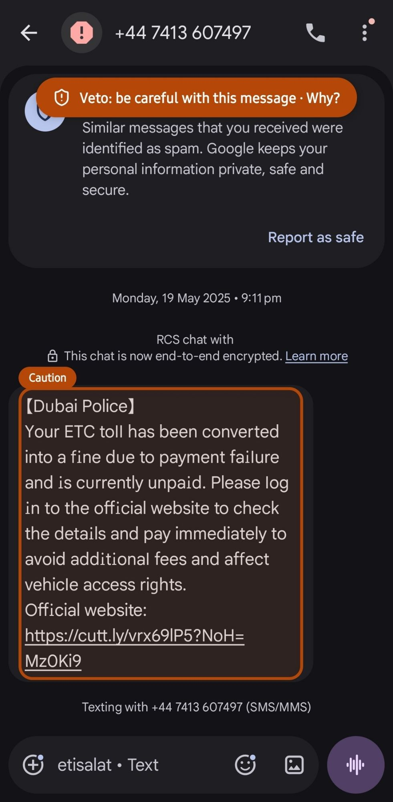
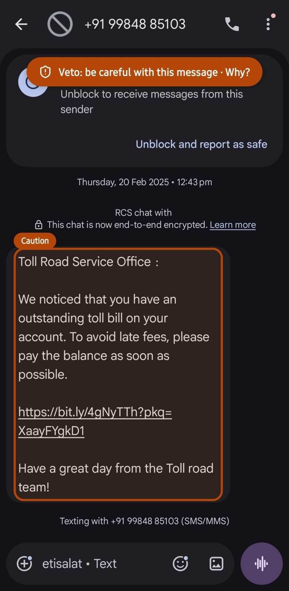
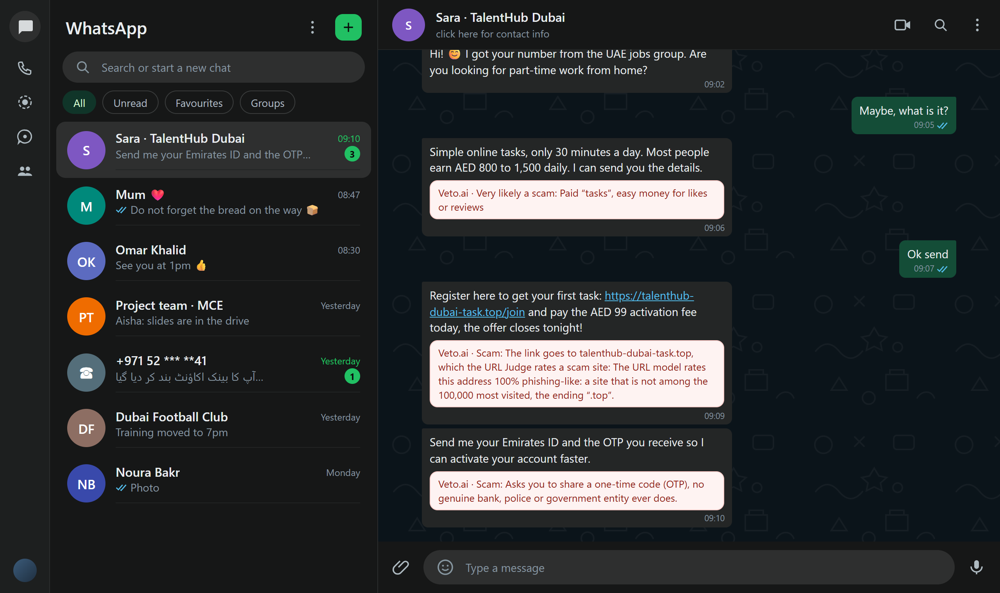
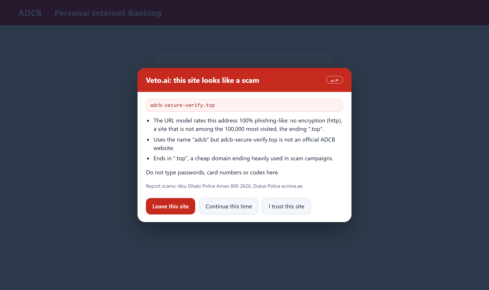

<p align="center"></p>

# Veto.ai: the scam guard that watches for you

**ScamShield AI hackathon · Abu Dhabi Police × 42 Abu Dhabi · Team veto.ai · November 2026**

> Most scam checkers wait for you to copy a suspicious message, open an app, paste it and ask "is this fake?".
> By then the victim has usually already tapped.
> **Veto.ai never waits to be asked.** It sits on top of the phone's messages and the computer's browser, checks every
> SMS, WhatsApp message, e-mail, link and website **the moment it arrives**, and warns inside the app the person is
> already using, in Arabic and English, with the reason and what to do next.

| | |
|---|---|
| **Live site: download the app** | **https://milki0069.github.io/veto-submission/** · download the Android app, see the permissions and install in one minute |
| **Test it in the browser** | https://milki0069.github.io/veto-submission/check/ · paste a message, a link or a whole list of links; same engine |
| **Demo video (1 minute)** | link in the submission form; the source and the real screenshots it uses are in [`tools/video-render.js`](tools/video-render.js) and [`docs/img/demo/`](docs/img/demo/) |
| **Android app** | [download veto.apk](https://github.com/MILKI0069/veto-submission/releases/latest/download/veto.apk) (also [`release/veto.apk`](release/veto.apk); source in [`android/`](android/)) |
| **Browser extension (Chrome, Edge)** | [`release/veto-extension.zip`](release/veto-extension.zip) · load unpacked; source in [`extension/`](extension/) |
| **Every number in this README** | traced to a file in [`docs/CLAIMS_LEDGER.md`](docs/CLAIMS_LEDGER.md); every test protocol written before it ran in [`docs/RESEARCH_LOG.md`](docs/RESEARCH_LOG.md) |

---

## Works fully offline: the benchmark

Every check in Veto runs **on the device, with no internet connection, no account and no server**. The numbers below were all
measured in offline mode: nothing was looked up online to reach them.

| Offline benchmark | Result |
|---|---|
| Links judged per second on an ordinary laptop, offline | **about 1,000** (about 1 ms per link) |
| Accuracy offline, 33,766 held-out links | **98.3 % precision, 94.5 % recall** |
| Scam SMS caught offline, on-device model | **96.9 %** (2.4 % false alarms) |
| Data that leaves the phone during a check | **none** |
| Size of the whole engine with its models | about **2 MB** in the browser extension, about **1.2 MB** for the Android app |

A scam that arrives in a basement car park, on roaming, or in a country with blocked services is caught the same way.
The online layer (following redirects, domain age, phishing feeds) and the AI second opinion are optional extras on top.

---

## Results at a glance

| What we measured | Result | Evidence |
|---|---|---|
| Phishing and legitimate links, held out by time and by domain | **98.3 % precision, 94.5 % recall** on **33,766** URLs | [`data/judge-report.json`](data/judge-report.json) |
| Phishing on domains the model never saw | **98.0 % precision, 95.0 % recall** (7,667 phishing URLs) | same report |
| Official UAE government and bank pages wrongly flagged | **0 of 2,231** | same report |
| A second phishing feed, domains never in training | **89.0 %** of 292,437 URLs caught | [`data/unseen-report.json`](data/unseen-report.json) |
| Scam SMS, 881 labelled texts, nested cross-validation | **96.9 %** caught (251 of 259), **2.4 %** false alarms | [`data/sms-cv-report.json`](data/sms-cv-report.json) |
| Look-alikes of UAE brands (ADNOC, Emaar, Property Finder ...) | **65.0 %** caught, up from 20.1 % after the UAE brand watchlist, with no rise in false alarms beyond 0.05 points | [`data/uae-watch-B.json`](data/uae-watch-B.json) |
| New certificates read live from 50 public certificate logs | **1,190 per second**, a median **17 s** after logging | [`data/ct-watch-report-run4.json`](data/ct-watch-report-run4.json) |
| Speed | about **1 ms per link**, offline; 20,000 links in one run | [`docs/RUN_LOG.md`](docs/RUN_LOG.md) |
| Automated tests | **153 of 153** pass, plus 9 of 9 browser checks of the extension | `npm test`, `npm run test:extension` |

The training data is public and dated: **472,582** URLs (OpenPhish history, Phishing.Database, PhiUSIIL and crawled
legitimate deep links), the **Tranco top 100,000** sites, **881** labelled SMS texts, the published rules and phone
numbers of **77 UAE institutions** and **34 UAE brands**. Tests use data that came **after** the training data, split so
that no domain is in both.

---

## What sets Veto apart

1. **No copy, no paste. It watches.** On Android, Veto reads each new SMS and WhatsApp notification as it arrives and
   draws its warning **on top of the messaging app**: a banner ("Veto: this message looks like a scam · Why?") and a
   highlight around the exact message. In the browser it labels messages inside WhatsApp Web, Google Messages,
   Telegram, Gmail and Outlook, and stops scam websites with a full-screen warning before anything is typed.
2. **Works offline, private by design.** The check runs on the device, with no internet needed. Veto looks for scam *patterns* (who a message claims to be,
   what it asks for, how it pressures, where its links really go); nothing is uploaded. An optional AI second opinion
   receives text only after card numbers, codes, phone numbers and e-mails are removed.
3. **It stays with the whole conversation.** Scammers groom first and send the link later. Every new message is
   checked when it appears, so a link slipped in on the tenth message is caught on the tenth message.
4. **It reads the rulebook, not just the text.** For each of 77 UAE banks, police forces and government bodies, Veto
   knows what that institution has publicly said it will **never** ask for (an OTP, a PIN, a remote-control app, a
   transfer to a "safe account") and its real domains and phone numbers. A message that claims to be Dubai Police but
   links to `cutt.ly` contradicts Dubai Police's own rules, and Veto says exactly that.
5. **It sees scam sites before the messages go out.** Veto reads the public certificate logs live and the daily lists of
   newly registered domains, and flags names that imitate UAE institutions and brands, often before the first SMS is
   sent.
6. **Any language.** Arabic and English are read by the rules. Urdu, Hindi, Tagalog, Malayalam, Russian and other
   languages common in the UAE are translated and checked by the AI layer, which can add a warning but never remove one.

---

## Real messages, real warnings

These are real SMS messages a team member received, with Veto's warnings drawn over Google Messages on a Samsung
Galaxy S25.

| Fake Dubai Police fine | Fake toll bill |
|---|---|
|  |  |

In the browser, the extension labels each step of a job-task scam as it appears, and stops a fake bank site:





---

## The scams Veto covers

| Channel | Scam | How Veto catches it |
|---|---|---|
| SMS | Fake fines, tolls, parcel fees, bank "account blocked" | the claimed sender's rules, the link's real owner, short links, cheap domain endings, the SMS model |
| SMS | One-time codes | explains what the code unlocks and warns never to share it; a code request in a message is flagged |
| WhatsApp, Telegram | Job and task scams, investment, romance, "family emergency" | grooming and pressure tactics, money and code requests, links judged as they appear |
| WhatsApp | Account takeover ("send me the 6-digit code") | code requests, Emirates ID requests |
| E-mail | Fake invoices, shared documents, login pages | the URL Judge on every link, files on public cloud buckets, victim e-mail addresses inside links |
| Web | Look-alike bank, police, government and brand sites | look-alike letters, brand names glued to other words, punycode, "@" tricks, the URL model, the popularity guard |
| Search and Maps | Fake customer-care numbers and listings | the listing check compares a listing's number and website with the institution's published ones |
| Calls | Calls followed by UAE PASS or authenticator approvals | the call watch warns when an approval app opens after an unknown call; the interceptor holds a call to a number from a scam message and offers the real one |

---

## How Veto meets each judging criterion

### Detection accuracy (30 %)
* **98.3 % precision and 94.5 % recall** on 33,766 held-out URLs; counting "suspicious" as flagged, recall 96.19 %.
* **0 of 2,231** official UAE pages flagged. The official allowlist and the gov.ae registry rule mean a real bank or
  government site is never called a scam.
* Resists evasion: short links, open redirects on trusted sites, defanged links (`hxxps://x[.]com`), punycode,
  "@" tricks and redirects are unwrapped and judged; the online mode follows each link to where it really lands.
* Every verdict comes with a score from 0 to 1 and the reasons, so a test set can be scored at any threshold
  (`npm run judge -- your-list.csv` prints precision, recall and F1).

| URL Judge, offline | URLs | Precision | Recall | F1 | False alarms |
|---|---|---|---|---|---|
| All held-out URLs | 33,766 (9,039 phishing, 24,727 legitimate) | 98.3 % | 94.5 % | 96.4 % | 0.59 % |
| Phishing on domains never seen in training | 7,667 phishing | 98.0 % | 95.0 % | 96.5 % | 0.59 % |

### Early detection and coverage (25 %)
* **Live certificate watch:** 50 public certificate logs (33 of the new tiled kind, where Let's Encrypt and Google now
  publish), 1,190 certificates checked per second, a median 17 seconds from logging to alert, alerts enriched with DNS
  and hosting network and linked into groups when they share an address.
* **Newly registered domains:** about 70,000 a day read in about 20 seconds; look-alikes of UAE institutions flagged.
* **Sentinel hunt:** about 10,000 look-alike names per hunt built from the official domains; the first live hunt
  found 568 registered look-alikes, 248 of them live.
* **Search, ads and Maps:** connectors for search results, paid ads and Maps listings, with the listing check for fake
  customer-care numbers.
* **Coverage of channels:** SMS, WhatsApp, Telegram, e-mail, websites, calls, search and Maps.

### Explainability and actionability (20 %)
* Every reason says where it came from (rule, model, official list, popularity, online check, feed or AI) and is
  written in plain English and Arabic.
* Every warning ends with what to do: do not reply or pay, call the institution's real number (shown), block the card
  if details were typed, and report to Abu Dhabi Police Aman 800 2626 or Dubai Police ecrime.ae.
* Evidence packs for takedown requests: a ZIP with a SHA-256 manifest, STIX 2.1 export, the registrar and abuse contact.

### UAE relevance and innovation (15 %)
* Built on the UAE's own rulebook: 77 institutions, their published phone numbers, domains and "we will never ask"
  statements; 34 more UAE brands on the look-alike watchlist.
* Arabic first-class: every verdict, reason and next step in Arabic and English; Arabic SMS and mixed Arabic-English
  messages are read by the rules.
* Innovation: the passive overlay (no pasting), the rulebook contradiction check, a live certificate watch tuned to UAE
  names, network linking of scam sites, and an AI layer that translates the languages of the UAE's residents.

### Feasibility and presentation (10 %)
* Runs today: an Android app, a Chrome and Edge extension, a web console, a police console and an HTTP API, all on one
  shared engine. No paid service is required; the AI layer is optional.
* Fast and light: about 1 ms per link offline on an ordinary laptop.
* Ready for a pilot: the API judges a whole list (`POST /api/v1/judge`), the police console runs hunts and exports
  evidence, and the claims ledger lets any reviewer reproduce each number.

---

## Try it

```bash
npm install
npm test                                   # 153 tests
npm run judge -- your-list.csv             # judge a list of URLs offline; add a label column for precision and recall
npm start                                  # web console, URL Judge page and police console on http://localhost:8787
npm run build:extension                    # then load build/extension unpacked in edge://extensions or chrome://extensions
npm run android                            # builds the Android app (release/veto.apk is prebuilt)
```

The URL list can be one URL per line or a CSV with a `url` column and an optional `label` column (`1/0`,
`phishing/legitimate`). The web page is `/judge.html`; the API is `POST /api/v1/judge`.

## Repository map

| Folder | What is in it |
|---|---|
| `engine/` | the shared engine: rules, URL Judge core, URL model, SMS model, message check, language scope, AI prompt |
| `server/` | the HTTP server, online checks, X-ray, Sentinel, evidence packs |
| `extension/` | the browser extension |
| `android/` | the Android app (notification and SMS checks, overlays, call watch, interceptor) |
| `web/`, `web-demo/` | the web console and the public live check |
| `data/` | the rulebook, the models and every measured report |
| `tools/` | training, evaluation, the certificate watch, builds and the demo video |
| `tests/` | 153 automated tests |
| `docs/` | the research log, the claims ledger, the technical report and the run log |

Full methodology, every experiment and its protocol: [`docs/TECHNICAL_REPORT.md`](docs/TECHNICAL_REPORT.md) and
[`docs/RESEARCH_LOG.md`](docs/RESEARCH_LOG.md).
