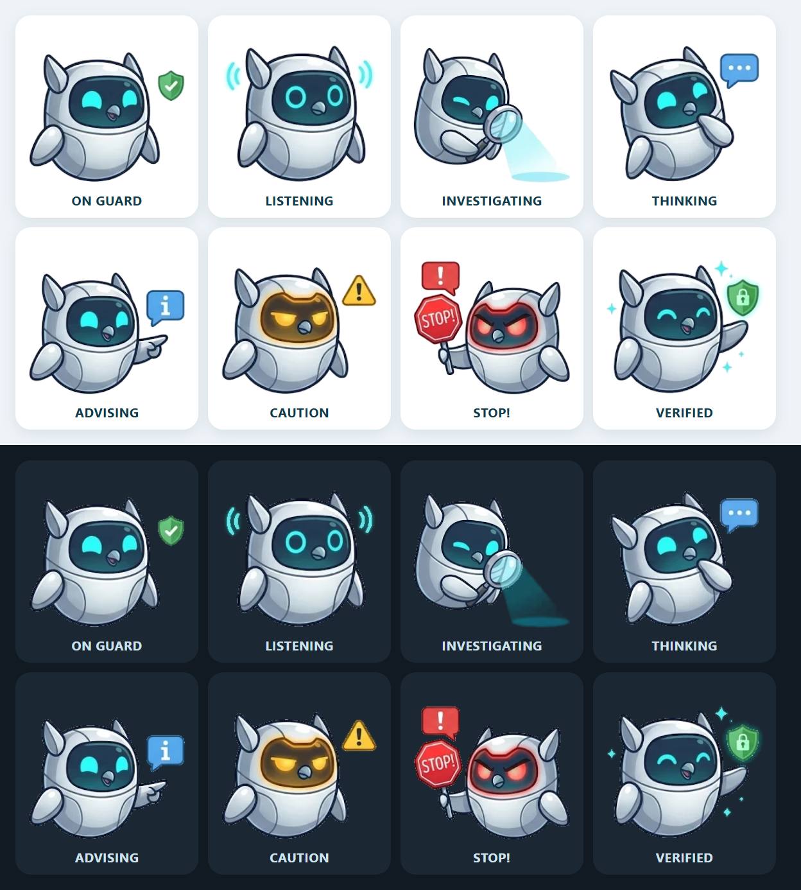

# Veto Companion: "Kiki", the scam-spotting pet for Android

_Built 20 Nov 2026, `android/` (build: `npm run android` → `android/build/veto.apk`, see `android/README.md`).
The phone app runs the same engine and rulebook as the web app._



Kiki is the team's own drawing, cut into 8 transparent sprites by `tools/extract-pet.js`
(`web/pet/*.png`, `android/app/src/main/res/drawable-nodpi/pet_*.png`).

## 1. What it does (user story)

You install Veto and switch on its permissions (each one explained on its own row). Then you forget it:
**Kiki is hidden. It only appears when something needs you.**

* **Trusted chats** (your family, long chat history): never analysed. Kiki stays hidden.
* **A stranger writes** (WhatsApp, SMS, Telegram, BOTIM…): read on the phone; if it's fine, nothing happens.
* **Something is wrong**: Kiki pops up red, a card slides over the chat and says *why*, in plain words, quoting
  the institution's own rule: *"Dubai Police never asks you to share your card's CVV."*
  *"Claims to be Dubai Police but writes from a Pakistan number (+92)."*
  *"Claims to be a family member, but your saved “Ahmed (son)” uses a different number."* ("Hi Mum, new number")
* **You reopen that chat later**: Kiki peeks out once, "Careful in this chat: …".
* **An unknown number calls**: before it rings Kiki checks it (country, one-ring ranges, your reports, optional
  online reputation) and stays at the edge of the screen while you talk ("I'm watching this call").
* **During that call a bank code arrives, or you open your bank app or AnyDesk, or install an app**: a **sharp beep
  in your ear**, vibration, a spoken "hang up now", and a red STOP card, without ever listening to the call.
* **You tap a link** (Link Shield): checked first; with online checks on, X-rayed in a sealed browser, what the page
  wants, where it sends your data, whether the app it pushes is a trojan.
* One tap: **report** (Aman 800 2626 / SMS 2828 / Dubai eCrime / copy the evidence), **warn a family member**, or
  **"I know them"** (Kiki learns, on the phone).

## 2. What is genuinely new (checked against existing products, Nov 2026)

| Already exists. We don't claim it | Veto's new step |
|---|---|
| WhatsApp context cards show facts about unknown senders: not a contact, another country, new account ([FoneArena](https://www.fonearena.com/blog/?p=483662)) | **Facts → contradictions.** Veto compares what the message *claims* with what the phone *knows*: "claims Dubai Police **but** a +92 WhatsApp", "claims to be your son **but** your saved son has another number". We found no app that checks family impersonation against your saved contacts. |
| Bitdefender Chat Protection scans *links* in chat apps ([Bitdefender](https://www.bitdefender.com/en-us/news/bitdefender-launches-industrys-first-chat-protection-feature-for-mobile-based-instant-messaging-applications)) | Veto reads *requests* (code, PIN, transfer, app install, approval) and checks them against **each institution's own published rules**, quoting them. |
| Google in-call protection: unknown caller + banking app + screen sharing → warning ([Google](https://blog.google/security/android-expands-pilot-in-call-scam-protection-financial-apps/)) | Veto adds **meaning** to device state: *what the code that just arrived unlocks* × *who you are on the phone with* × *the institution's rules*, plus "an app was installed during the call". Any Android 10+ phone, Arabic, UAE. |
| Google's on-device call Scam Detection listens to calls, Pixel only, selected countries | **No call audio needed**, Android blocks call audio for third-party apps anyway. Veto catches the scam's *footprints* around the call. |
| Truecaller / Hiya: caller reputation (Truecaller has no public look-up API) | Caller check that **explains**: one-ring ranges, hidden numbers, "this IS ADCB's number, but caller ID can be faked", numbers you reported, optional IPQualityScore reputation (sends only the number). |
| URL scanners say "malicious / clean" | **X-ray says what the page wants and where it sends your data**: Veto types FAKE details into the page in a sealed browser and catches the send (Telegram bot, Discord webhook, Google Sheet…), and blocks it. Reads the app a page pushes (without installing) and names a banking-trojan toolkit. |
| Content moderation filters every message on a server | **Trust-gated attention on the device**: family chats are never read; strangers are watched. Privacy *and* battery. |
| Warnings lose effect as people get used to them (habituation; [Vance et al.](https://misq.umn.edu/pub/skin/frontend/default/misq/pdf/V42I2/14124_RA_VanceJenkins.pdf)) | A pet that is **absent until it matters**, then changes shape, colour, motion and sound with the danger level, a *polymorphic*, rare warning. |

## 3. How it works on Android (as built)

| Feature | Android mechanism | File |
|---|---|---|
| Kiki + red warning card over any app | `WindowManager` overlay (`TYPE_APPLICATION_OVERLAY`), draggable, auto-hides | `Overlay.java` |
| New messages from WhatsApp / SMS / Telegram / Signal / BOTIM … | `NotificationListenerService` (sender + text of each new notification, incl. MessagingStyle) | `ChatListener.java` |
| Unknown incoming calls (before ringing) | `CallScreeningService` (call-screening role), always *allows* the call; STIR/SHAKEN status where available | `CallGuard.java` |
| On a call / ringing / missed after a short ring | `TelephonyCallback` (Android 12+) / `PhoneStateListener` | `Watchers.java` |
| Bank app / AnyDesk opened during an unknown call; reopening a flagged chat | `UsageStatsManager` events, polled **only** while such a call or flagged chat is active | `Watchers.java` |
| App installed during / right after an unknown call | `ACTION_PACKAGE_ADDED` receiver | `Watchers.java`, `Veto.java` |
| Saved contacts ("Hi Mum" check), chat-history trust | `ContactsContract` + on-device ledger (hashed sender → count, first-seen date) | `Contacts.java`, `Store.java` |
| Sharp beep + vibration + "hang up now" | `ToneGenerator` on the **call stream** during calls, `Vibrator`, `TextToSpeech` | `Alarm.java` |
| Link Shield / "Share → Veto" | `ACTION_VIEW` http(s) handler (default-browser role), `ACTION_SEND` text; forwards safe links to the real browser explicitly | `LinkShieldActivity.java` |
| Caller reputation (optional) | IPQualityScore with the user's own key, or the Veto server's `/api/number` | `Net.java` |
| The brain | the same `engine/*.js` + `data/*.js` in an off-screen WebView (network blocked; assets only) | `Engine.java`, `assets/www/bridge.js` |
| Report / warn family | `tel:8002626`, `smsto:2828`, eCrime URL, clipboard, share sheet, the user presses send | `Overlay.java` |
| ❌ Listening to the call | Not possible (Android 10+), not needed | n/a |

### Attention gating (why it doesn't run 24/7)

```
message arrives ─► trust ledger ─► SLEEP  (saved contact, ≥20 messages or ≥90 days, nothing "hot") → not analysed, Kiki hidden
                                 ├► LIGHT  (trusted, but mentions a code / money / link)         → full check
                                 └► WATCH  (unknown, first message, foreign, new account)        → full check
unknown call ─► Kiki at the edge ─► app-in-front polling ON (only for this call) ─► OFF when the call ends
```

### Kiki's moods ↔ what triggers them

| Kiki | When it appears |
|---|---|
| (hidden) | default; trusted chats; nothing to do |
| 👂 Listening | an unknown number is calling / you are on that call |
| 🔎 Investigating | Link Shield / X-ray at work |
| 💭 Thinking | (web) AI deep check |
| ℹ️ Advising | a call from an official number (with the spoofing caveat); one-time-code advice |
| ⚠️ Caution (amber) | warning signs, one-ring missed call, reopening a flagged chat, app installed after a call |
| 🛑 STOP (red, shaking, beep) | scam verdict; code / bank app / AnyDesk during an unknown call; reported number calling |
| ✅ Verified (green) | official link or sender |

## 4. Privacy and safety by design
* Everything runs **on the phone**. Detection needs no internet; online checks are **off by default** and send only a
  link or a number (never message text, names or contacts).
* Trusted chats are **never read**. Messages from others are analysed **in memory** and discarded; the ledger keeps
  hashed counts and dates only.
* **Read-only**: Veto never taps, types, replies, forwards or deletes; reports open the dialer / SMS / share sheet.
* The engine's WebView cannot reach the network (every non-asset request is refused).
* The same permissions are abused by malware, so every permission has its own explained row, and Kiki is visible
  whenever Veto is actively watching (calls / flagged chats).

## 5. Honest limits
* No call audio on the same phone (Android rule). WhatsApp *calls* are not visible to the call-screening role.
* Notification text can be truncated or hidden (if the user hides previews).
* iPhone cannot run any of this (iOS forbids reading other apps or drawing over them), iPhone users keep the web app.
* The trust ledger starts empty: the first days rely on contacts only.
* Bank-app detection matches app names; the one-ring list is a short, conservative set of ranges.

## Known privacy gaps (24 Nov review; not fixed yet)

Checked in the code on 24 Nov 2026. Verified as designed: other apps' notifications are dropped before they are read (`ChatListener.onNotificationPosted`); foreground-app polling runs only while a call with an unknown number or a flagged chat is active (`Veto.needsWatching`, `Watchers.java`); the in-app WebView refuses every request except the local asset host (`Engine.java`, `shouldInterceptRequest`).

1. **Plain-text secrets and lists.** The IPQS key and the list of reported numbers sit in ordinary SharedPreferences (`Store.java`: `ipqsKey`, `reported`). Plan: encrypt them with the Android Keystore (roadmap E3). Not changed in this pass: it needs a device test.
2. **Accessibility permission.** The optional in-chat highlighter declares the Accessibility service (`AndroidManifest.xml`). Plan: a prominent disclosure before it is switched on; read-only; limited to the chat apps the user chose; check the Google Play policy before any release.
3. **Hashed numbers are not anonymous.** The space of phone numbers is small enough to enumerate, so a hash can be reversed. Never describe number hashes as anonymous, and share only aggregate counts with police.
4. **No user view of what was read.** Users cannot yet see or wipe what Veto read. Plan: a Privacy Ledger on the phone (roadmap E2).
5. **Legal scope.** Law-firm summaries of the UAE Personal Data Protection Law disagree on the government and security exclusions. Check the official text with counsel before a police-run deployment is described as outside the law.
6. **Not checked in this pass:** whether the trusted-chat rule (family chats are never analysed) is enforced in code or only documented here.
